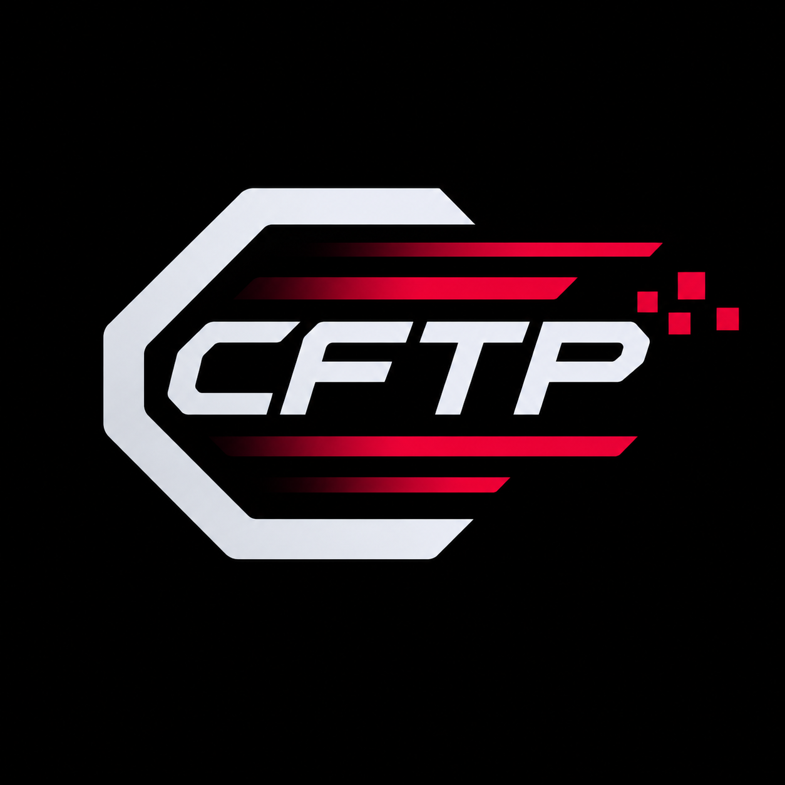

<!-- markdownlint-disable MD033 MD041 -->
<p align="center">
  
</p>
<!-- markdownlint-enable MD033 -->

# cftp

Fast file and directory transfers over QUIC, authenticated with SSH keys, with zstd compression.

[](https://github.com/connythecreator/cftp/actions/workflows/ci.yml)
[](LICENSE)
[](https://www.rust-lang.org)

cftp (Connys File Transfer Program) pushes and pulls files and directory trees
over QUIC. It authenticates with SSH keys by default, uses zstd for compression,
and BLAKE3 for integrity checks. Small files are packed together and large files
are split into chunks. The server is authoritative: it decides which modes it
accepts and which paths clients may read or write.

## Features

- QUIC transport with ALPN `cftp/4`, `cftp/3`, and `cftp/2` fallback.
- Push (`put`) and pull (`get`) from the same server.
- Server-side policy: `serve --no-push`, `serve --no-pull`, or both modes.
- SSH-key authentication by default, using `authorized_keys`, a cftp-managed
  host key, and `~/.config/cftp/known_hosts`.
- `put`/`get --via-ssh` starts a temporary server over your existing SSH login,
  so a first transfer needs no manual key exchange.
- `cftp keygen` and `cftp pubkey` helpers for setting up keys.
- Optional mutual TLS with a local CA.
- Light, default, and aggressive hardware profiles.
- Live profile hotkeys during `put`, with server-side caps.
- zstd compression, skipping known incompressible file extensions.
- Adaptive congestion control: CUBIC on clean paths, switching to BBR when
  the path shows sustained packet loss.
- Small-file packs and offset-based chunks for large files.
- BLAKE3 integrity checks for every pack entry and chunk.
- Atomic writes, preserved mtimes, and preserved modes on Unix.
- Symlink support on Unix, with escape protection.
- Path traversal and symlink-escape rejection.
- Local directory copy when the destination is not a `cftp://` URL.
- Live read, sent, received, and written throughput in the progress bar.
- Progress bars, with `--quiet` to disable them.
- Embeddable `cftp-core` library: `push`, `pull`, and `serve` as async
  functions, with progress channels, cancellation by aborting the task, and a
  download-manager example.

## Documentation

- [Wiki home](docs/wiki/Home.md)
- [Architecture and protocol](docs/architecture.md)
- [Packaging and releases](docs/packaging.md)
- [Contributing](.github/CONTRIBUTING.md)
- [Security policy](.github/SECURITY.md)
- [Changelog](CHANGELOG.md)

## Requirements

- Rust 1.88 or newer to build from source.
- An SSH key pair on each machine. `cftp keygen` creates one, or cftp uses the
  first existing key from `~/.ssh`.
- For a permanent server: the sender's public key in the receiver's
  `~/.ssh/authorized_keys`. `--via-ssh` skips this step, but needs the OpenSSH
  client on the sender.
- UDP port `4433` (default) reachable between peers.
- Linux, macOS, or Windows for source builds. Packages are currently Linux-only.
- Docker if you want to build the Arch package on a non-Arch host.

## Installation

### Debian and Ubuntu

Download the `.deb` from the [latest release](https://github.com/connythecreator/cftp/releases)
and install it:

```bash
sudo apt install ./cftp_*_amd64.deb
```

### Arch Linux

Download the package from the [latest release](https://github.com/connythecreator/cftp/releases)
and install it:

```bash
sudo pacman -U cftp-*-x86_64.pkg.tar.zst
```

Packaging files live in `packaging/arch/`. The package is not published to the
AUR yet.

### From source

```bash
cargo install --path crates/cftp-cli --locked
```

Or build a release binary without installing it:

```bash
cargo build --release --locked
./target/release/cftp --help
```

## Quick start

Install cftp on both machines. If you can already `ssh` from the sender to the
receiver, one command starts a temporary server there and pushes the tree:

```bash
cftp put ./project project --via-ssh you@receiver
```

`--via-ssh` uses your existing SSH login as the trust root. It runs
`cftp serve --one-shot` on the receiver (writing under the remote home
directory), learns the receiver's cftp host key over that authenticated channel,
and authorizes your client key for that single transfer only. No persistent
server and no manual key exchange are needed. The destination (`project` above,
or `/project`) is interpreted relative to the remote home directory. SSH is only
the bootstrap: UDP port `4433` (or the port after the host, e.g.
`--via-ssh you@receiver:4444`) must still be reachable directly between the
machines.

To run a permanent receiver instead, authorize the sender once and start the
listener:

```bash
# On the sender: print the public key to authorize on the receiver.
cftp pubkey

# On the receiver: paste that line into ~/.ssh/authorized_keys, then start
# the listener (the root and host key are created on first run).
cftp serve --root ~/incoming

# On the sender:
cftp put ./project cftp://receiver:4433/project
```

`serve` generates `~/.config/cftp/host_key` the first time it runs, so the
receiver needs no setup beyond `authorized_keys`. The sender uses the first
existing key from `~/.ssh/id_ed25519`, `id_ecdsa`, or `id_rsa`, and verifies the
receiver against `~/.config/cftp/known_hosts`. The first connection prints the
receiver's host-key fingerprint and asks you to confirm it, like `scp`. In
scripts, pass `--accept-new` to add an unknown host key automatically.

`serve` prints the URLs other machines can use, and writes the transfer under
`~/incoming/project/`. By default it stays alive and accepts further transfers
(up to four at a time); pass `--one-shot` to make it exit after the first
successful transfer.

To pull from the same receiver, point `get` at a path under its root:

```bash
cftp get cftp://receiver:4433/project/ ./downloads
# or, with an SSH bootstrap:
cftp get project ./downloads --via-ssh you@receiver
```

Pull requires `cftp/4` on both peers. The server decides whether pushes and
pulls are allowed; with `serve --no-pull` a client's `get` fails with a clear
message before any data is sent.

During a remote `put`, press `l`, `d`, or `a` to switch between light, default,
and aggressive profiles without restarting the transfer. The server may reject
a request above its configured cap; the transfer continues at the current
profile.

### Hardware profiles

| Profile | Intended use |
| --- | --- |
| `--light` | Minimal CPU, memory, and network usage. |
| `--default` | The default tuning. |
| `--aggressive` | Saturate CPU, memory, and network for the fastest transfer. |

`serve` defaults to a `default` cap. Run `serve --aggressive` to allow clients
to request aggressive mode; `serve --light` caps all clients at light.
`--aggressive` uses the detected link speed and observed transfer throughput
to choose zstd levels while the transfer runs. Independently of the profile,
every connection starts on CUBIC and switches to BBR if its path shows
sustained packet loss; clean paths keep CUBIC.

Profiles are mutually exclusive with `--chunk-size`, `--pack-target`,
`--pack-max-files`, and `--small-file-max`.

Older `cftp/2` and `cftp/3` peers still work for pushes. Profile flags and
hotkeys are ignored on `cftp/2`, and pull is refused unless both peers speak
`cftp/4`.

To copy locally instead of over the network:

```bash
cftp put ./project ./backup
```

A trailing slash on a directory source transfers its contents; without it, the
source directory name is preserved:

```bash
cftp put ./project/ cftp://receiver:4433/destination
```

`get` follows the same rule for the remote source, and the result is written
under the local destination:

```bash
cftp get cftp://receiver:4433/project/ ./downloads   # contents of project/
cftp get cftp://receiver:4433/project ./downloads    # downloads/project/
cftp get ./backup ./restored                         # local copy
```

### Manual certificate mode

SSH authentication is the default. The original mutual-TLS mode is still
available and is selected automatically when any certificate flag is passed, or
explicitly with `--auth cert`:

```bash
cftp identity init
cftp serve --root ./incoming --auth cert
cftp put ./project/ cftp://receiver:4433/project --auth cert
```

You can still generate an identity on each machine and exchange only the CA
certificates:

- On the server, pass the client's CA with `--client-ca`.
- On the client, pass the server's CA with `--server-ca`.

The generated leaf certificate uses `cftp.local` as its name, so the client's
default `--server-name cftp.local` continues to work.

## Command reference

### `cftp identity init`

| Flag | Description |
| --- | --- |
| `--dir <DIR>` | Write `ca.pem`, `identity.pem`, and `identity.key` to this directory instead of the platform config directory. |
| `--force` | Replace existing identity files. |

On Linux the default directory is `~/.config/cftp`.

### `cftp keygen`

Creates an Ed25519 key pair for cftp to present to servers. Existing files are
never overwritten without `--force`.

| Flag | Description |
| --- | --- |
| `--output <FILE>`, `-f` | Private key file to create. Defaults to `~/.ssh/id_ed25519`. |
| `--force` | Replace an existing key file. |

The public key is written next to the private key with a `.pub` suffix and
printed along with the fingerprint and a ready-to-run command for authorizing
it on a server.

### `cftp pubkey`

Prints the OpenSSH public key for a private key, which is convenient for
piping into a server's `authorized_keys`.

| Flag | Description |
| --- | --- |
| `--key <FILE>`, `-f` | Private key to read. Defaults to the first key found in `~/.ssh`. |

### `cftp serve`

| Flag | Description |
| --- | --- |
| `--root <DIR>` | Required. Directory that received files are written under and pulled files are read from. Created if it does not exist. |
| `--listen <ADDR>` | UDP address to listen on. Defaults to `0.0.0.0:4433`. |
| `--one-shot` | Exit after the first successful transfer instead of staying alive. |
| `--no-push` | Refuse pushes from clients. |
| `--no-pull` | Refuse pulls from clients. |
| `--max-sessions <N>` | Maximum concurrent transfers while staying alive. Defaults to 4. |
| `--auth <auto\|ssh\|cert>` | Authentication backend. Defaults to `auto`. |
| `--light` / `--default` / `--aggressive` | Maximum hardware profile accepted from clients. Defaults to `default`. |
| `--host-key <FILE>` | SSH host key. Defaults to `~/.config/cftp/host_key` and is generated on first use. |
| `--authorized-keys <FILE>` | SSH keys allowed to connect. Defaults to `~/.ssh/authorized_keys`. |
| `--identity <FILE>` | Leaf certificate presented to clients (cert mode). |
| `--key <FILE>` | Private key for the leaf certificate (cert mode). |
| `--client-ca <FILE>` | CA used to verify client certificates (cert mode). |
| `--quiet` | Disable the progress bar. |

### `cftp put`

| Argument or flag | Description |
| --- | --- |
| `<SRC>` | Source file or directory. |
| `<DEST>` | A `cftp://host[:port]/path` URL, a local destination directory, or (with `--via-ssh`) a remote path such as `project` or `/project`. |
| `--via-ssh <[USER@]HOST[:PORT]>` | Run a one-shot server on `HOST` over SSH and push to it, using the SSH login as the trust root. The destination is relative to the remote home directory. |
| `--auth <auto\|ssh\|cert>` | Authentication backend. Defaults to `auto`. |
| `--light` / `--default` / `--aggressive` | Requested hardware profile. Defaults to `default`. Hotkeys override it during the transfer. |
| `--ssh-key <FILE>` | SSH private key presented to the server. Defaults to the first of `~/.ssh/id_ed25519`, `id_ecdsa`, `id_rsa`. |
| `--known-hosts <FILE>` | Host keys used to verify the server. Defaults to `~/.config/cftp/known_hosts`. |
| `--accept-new` | Add an unknown server host key to `known_hosts` without prompting. |
| `--identity <FILE>` | Leaf certificate presented to the server (cert mode). |
| `--key <FILE>` | Private key for the leaf certificate (cert mode). |
| `--server-ca <FILE>` | CA used to verify the server certificate (cert mode). |
| `--server-name <NAME>` | Expected server name. Defaults to `cftp.local`. |
| `--quiet` | Disable the progress bar. |
| `--stats` | Print QUIC transport counters (RTT, congestion window, loss) after the transfer. |
| `--chunk-size <BYTES>` | Large-file chunk size. Defaults to the profile's size (4 MiB for default and aggressive, 256 KiB for light). |
| `--pack-target <BYTES>` | Target size of a small-file pack. Defaults to 4 MiB. |
| `--pack-max-files <N>` | Maximum files per pack. Defaults to 128. |
| `--small-file-max <BYTES>` | Files at or below this size are packed. Defaults to 2 MiB. |

The default port for a remote destination is `4433`. Only the `cftp://` scheme
is accepted; any other `://` destination is rejected. scp-style `host:path`
destinations are rejected too, with a hint pointing at `cftp://host/path` or
`--via-ssh host:/path`.

### `cftp get`

| Argument or flag | Description |
| --- | --- |
| `<SRC>` | A `cftp://host[:port]/path` URL, a local source file or directory, or (with `--via-ssh`) a remote path such as `project` or `/project`. |
| `<DEST>` | Local destination directory. |
| `--via-ssh <[USER@]HOST[:PORT]>` | Run a one-shot server on `HOST` over SSH and pull from it, using the SSH login as the trust root. The source is relative to the remote home directory. |
| `--auth <auto\|ssh\|cert>` | Authentication backend. Defaults to `auto`. |
| `--light` / `--default` / `--aggressive` | Requested hardware profile. Defaults to `default`. |
| `--ssh-key <FILE>` | SSH private key presented to the server. Defaults to the first of `~/.ssh/id_ed25519`, `id_ecdsa`, `id_rsa`. |
| `--known-hosts <FILE>` | Host keys used to verify the server. Defaults to `~/.config/cftp/known_hosts`. |
| `--accept-new` | Add an unknown server host key to `known_hosts` without prompting. |
| `--identity <FILE>` | Leaf certificate presented to the server (cert mode). |
| `--key <FILE>` | Private key for the leaf certificate (cert mode). |
| `--server-ca <FILE>` | CA used to verify the server certificate (cert mode). |
| `--server-name <NAME>` | Expected server name. Defaults to `cftp.local`. |
| `--quiet` | Disable the progress bar. |
| `--stats` | Print QUIC transport counters (RTT, congestion window, loss) after the transfer. |

A remote `get` requires `cftp/4`. The server resolves the requested path under
its root, refusing traversal and symlink escapes, and streams the tree using the
same packs and chunks as `put`.

## Throughput

The client progress bar shows four rates:

- `read`: source bytes read by the client.
- `sent`: payload bytes sent by the client.
- `recv`: payload bytes received by the server.
- `write`: logical bytes written to disk by the server.

Rates are displayed in bits per second (`Gbps`, `Mbps`, `Kbps`, or `bps`) and
are application-level estimates over a short window, not operating system
interface counters. Compression means `read`/`write` can differ substantially
from `sent`/`recv`.

## Benchmarks

<!-- BENCH_RESULTS:START -->
Generated by the cftp benchmark harness (cftp 0.3.0) on Docker ubuntu:24.04, loopback. Median of 3 run(s); lower is better. Gate: **passed** (cftp within 5.0% of the fastest security-equivalent peer).

### Encrypted transports (gate)

| Dataset | cftp | scp | SFTP | HTTPS | Fastest secure peer |
| --- | ---: | ---: | ---: | ---: | --- |
| many-small (7.8 MiB, 2000 files) | 0.304s (25.7 MiB/s) | 1.642s (4.8 MiB/s) | 1.309s (6.0 MiB/s) | 20.608s (0.4 MiB/s) | SFTP |
| large (256.0 MiB, 1 file) | 0.429s (596.6 MiB/s) | 1.007s (254.1 MiB/s) | 0.987s (259.3 MiB/s) | 0.454s (564.2 MiB/s) | HTTPS |
| mixed (33.0 MiB, 137 files) | 0.084s (394.8 MiB/s) | 0.524s (63.0 MiB/s) | 0.494s (66.9 MiB/s) | 1.469s (22.5 MiB/s) | SFTP |
| huge (1024.0 MiB, 1 file) | 1.514s (676.4 MiB/s) | 3.154s (324.7 MiB/s) | 3.044s (336.4 MiB/s) | 1.664s (615.6 MiB/s) | HTTPS |

### Plaintext reference (not gated)

These peers send the payload in the clear. They are measured to show what the same hardware does without encryption or integrity protection, and are excluded from the gate.

| Dataset | FTP | HTTP |
| --- | ---: | ---: |
| many-small (7.8 MiB, 2000 files) | 101.209s (0.1 MiB/s) | 20.559s (0.4 MiB/s) |
| large (256.0 MiB, 1 file) | 0.353s (725.5 MiB/s) | 0.202s (1267.7 MiB/s) |
| mixed (33.0 MiB, 137 files) | 6.948s (4.7 MiB/s) | 1.438s (23.0 MiB/s) |
| huge (1024.0 MiB, 1 file) | 2.681s (381.9 MiB/s) | 0.737s (1389.9 MiB/s) |
<!-- BENCH_RESULTS:END -->

Results come from `make bench-gate`: cftp, scp, SFTP, HTTPS, FTP, and HTTP in one
Docker container over loopback, medians of repeated runs (`BENCH_ITERATIONS`,
default 3), with byte-for-byte verification after the timer stops. The release
gate fails when cftp is more than 5% slower than the fastest
security-equivalent peer (scp, SFTP, HTTPS) on any dataset. CI runs it with
`CFTP_BENCH_GATE_TOLERANCE=25` because GitHub's shared runners vary in CPU
model enough to move that ratio by more than 20% for identical builds; a
dedicated machine keeps the 5% bar. FTP and HTTP are plaintext and are
published as reference rows only. The gate also runs a 1 GiB `huge` dataset with the aggressive profile, and
removes each upload once it has been measured, so the run holds one generated
dataset plus one copy instead of one copy per peer. See
[the benchmark page](docs/wiki/Benchmarks.md) for
the full note and `bench/README.md` for the method.

## Security

By default, peers authenticate with SSH keys. The server checks client keys
against `authorized_keys` and refuses entries carrying options it cannot enforce
(only restriction-only flags such as `no-pty` and `restrict` are accepted). The
client pins server keys in `~/.config/cftp/known_hosts`, which follows OpenSSH
port semantics: a bare host pattern covers port 22, and every other port is
written as `[host]:port`. cftp's own entries are always bracketed, and a changed
host key is rejected.

`--via-ssh` never weakens that: the remote host key is learned over the
authenticated SSH connection, pinned for the session, and written to
`known_hosts` only if you have not already pinned a different key for that host.

Transfers protect data in transit with QUIC/TLS 1.3, received paths are confined
to the destination root, and files are written atomically with mode 0600
temporary files. Certificate mode remains available for deployments that prefer
a shared CA. In that mode the CA *is* the identity, because any certificate the
CA signed is accepted: only use a `ca.pem` you obtained from an administrator
you trust. See [architecture and protocol](docs/architecture.md) for the full
security model and [the security policy](.github/SECURITY.md) for reporting
vulnerabilities.

## Development

```bash
cargo build --release --locked
cargo test --workspace --locked
make check
```

See [CONTRIBUTING.md](.github/CONTRIBUTING.md) for coding standards, protocol
rules, and the pull request checklist.

## Packaging

See [packaging and releases](docs/packaging.md) for Debian, Arch, and release
workflows.

## License

cftp is licensed under GPL-3.0-only. See [LICENSE](LICENSE).
