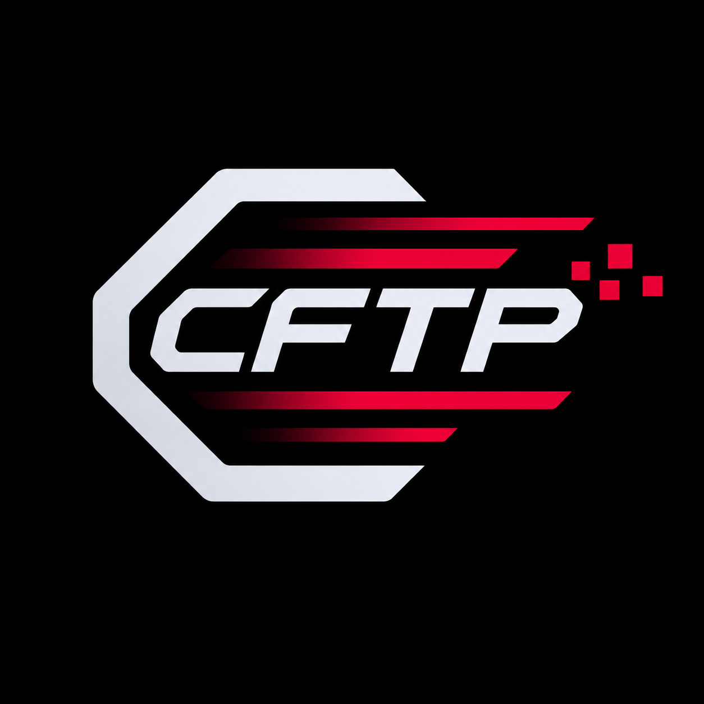

<!-- markdownlint-disable MD033 MD041 -->
<p align="center">
  
</p>
<!-- markdownlint-enable MD033 -->

# cftp

Fast file and directory transfers over QUIC, with mutual TLS and zstd compression.

[](https://github.com/connythecreator/cftp/actions/workflows/ci.yml)
[](LICENSE)
[](https://www.rust-lang.org)

cftp (Connys File Transfer Program) pushes and pulls files and directory trees
over QUIC. It authenticates with SSH keys by default, uses zstd for compression,
and BLAKE3 for integrity checks. Small files are packed together and large files
are split into chunks. The server is authoritative: it decides which modes it
accepts and which paths clients may read or write.

## Features

- QUIC transport with ALPN `cftp/4`, `cftp/3`, and `cftp/2` fallback.
- Push (`put`) and pull (`get`) from the same server.
- Server-side policy: `serve --no-push`, `serve --no-pull`, or both modes.
- SSH-key authentication by default, using `authorized_keys` and `known_hosts`.
- Optional mutual TLS with a local CA.
- Light, default, and aggressive hardware profiles.
- Live profile hotkeys during `put`, with server-side caps.
- zstd compression, skipping known incompressible file extensions.
- Small-file packs and offset-based chunks for large files.
- BLAKE3 integrity checks for every pack entry and chunk.
- Atomic writes, preserved mtimes, and preserved modes on Unix.
- Symlink support on Unix, with escape protection.
- Path traversal and symlink-escape rejection.
- Local directory copy when the destination is not a `cftp://` URL.
- Live read, sent, received, and written throughput in the progress bar.
- Progress bars, with `--quiet` to disable them.

## Documentation

- [Wiki home](docs/wiki/Home.md)
- [Architecture and protocol](docs/architecture.md)
- [Packaging and releases](docs/packaging.md)
- [Contributing](.github/CONTRIBUTING.md)
- [Security policy](.github/SECURITY.md)
- [Changelog](CHANGELOG.md)

## Requirements

- Rust 1.88 or newer to build from source.
- An SSH key pair, and the peer's public key in `~/.ssh/authorized_keys`.
- UDP port `4433` (default) reachable between peers.
- Linux, macOS, or Windows for source builds. Packages are currently Linux-only.
- Docker if you want to build the Arch package on a non-Arch host.

## Installation

### Debian and Ubuntu

Download the `.deb` from the [latest release](https://github.com/connythecreator/cftp/releases)
and install it:

```bash
sudo apt install ./cftp_*_amd64.deb
```

### Arch Linux

Download the package from the [latest release](https://github.com/connythecreator/cftp/releases)
and install it:

```bash
sudo pacman -U cftp-*-x86_64.pkg.tar.zst
```

Packaging files live in `packaging/arch/`. The package is not published to the
AUR yet.

### From source

```bash
cargo install --path crates/cftp-cli --locked
```

Or build a release binary without installing it:

```bash
cargo build --release --locked
./target/release/cftp --help
```

## Quick start

cftp uses SSH keys by default. On the receiver, add the sender's public key to
`~/.ssh/authorized_keys` and start the listener:

```bash
cat ~/.ssh/id_ed25519.pub >> ~/.ssh/authorized_keys
cftp serve --root ./incoming
```

The receiver uses `~/.ssh/id_ed25519` as its host key. On the sender:

```bash
cftp put ./project/ cftp://receiver:4433/project
```

The sender uses the first existing key from `~/.ssh/id_ed25519`,
`~/.ssh/id_ecdsa`, or `~/.ssh/id_rsa`, and verifies the receiver against
`~/.ssh/known_hosts`. The first connection prints the receiver's host-key
fingerprint and asks you to confirm it, like `scp`. In scripts, pass
`--accept-new` to add an unknown host key automatically.

The receiver writes the transfer under `./incoming/project/`. By default
`serve` stays alive and accepts further transfers (up to four at a time); pass
`--one-shot` to make it exit after the first successful transfer.

To pull from the same receiver, point `get` at a path under its root:

```bash
cftp get cftp://receiver:4433/project/ ./downloads
```

Pull requires `cftp/4` on both peers. The server decides whether pushes and
pulls are allowed; with `serve --no-pull` a client's `get` fails with a clear
message before any data is sent.

During a remote `put`, press `l`, `d`, or `a` to switch between light, default,
and aggressive profiles without restarting the transfer. The server may reject
a request above its configured cap; the transfer continues at the current
profile.

### Hardware profiles

| Profile | Intended use |
| --- | --- |
| `--light` | Minimal CPU, memory, and network usage. |
| `--default` | The default tuning. |
| `--aggressive` | Saturate CPU, memory, and network for the fastest transfer. |

`serve` defaults to a `default` cap. Run `serve --aggressive` to allow clients
to request aggressive mode; `serve --light` caps all clients at light.
`--aggressive` uses the detected link speed and observed transfer throughput
to choose zstd levels while the transfer runs.

Profiles are mutually exclusive with `--chunk-size`, `--pack-target`,
`--pack-max-files`, and `--small-file-max`.

Older `cftp/2` and `cftp/3` peers still work for pushes. Profile flags and
hotkeys are ignored on `cftp/2`, and pull is refused unless both peers speak
`cftp/4`.

To copy locally instead of over the network:

```bash
cftp put ./project ./backup
```

A trailing slash on a directory source transfers its contents; without it, the
source directory name is preserved:

```bash
cftp put ./project/ cftp://receiver:4433/destination
```

`get` follows the same rule for the remote source, and the result is written
under the local destination:

```bash
cftp get cftp://receiver:4433/project/ ./downloads   # contents of project/
cftp get cftp://receiver:4433/project ./downloads    # downloads/project/
cftp get ./backup ./restored                         # local copy
```

### Manual certificate mode

SSH authentication is the default. The original mutual-TLS mode is still
available and is selected automatically when any certificate flag is passed, or
explicitly with `--auth cert`:

```bash
cftp identity init
cftp serve --root ./incoming --auth cert
cftp put ./project/ cftp://receiver:4433/project --auth cert
```

You can still generate an identity on each machine and exchange only the CA
certificates:

- On the server, pass the client's CA with `--client-ca`.
- On the client, pass the server's CA with `--server-ca`.

The generated leaf certificate uses `cftp.local` as its name, so the client's
default `--server-name cftp.local` continues to work.

## Command reference

### `cftp identity init`

| Flag | Description |
| --- | --- |
| `--dir <DIR>` | Write `ca.pem`, `identity.pem`, and `identity.key` to this directory instead of the platform config directory. |
| `--force` | Replace existing identity files. |

On Linux the default directory is `~/.config/cftp`.

### `cftp serve`

| Flag | Description |
| --- | --- |
| `--root <DIR>` | Required. Directory that received files are written under and pulled files are read from. |
| `--listen <ADDR>` | UDP address to listen on. Defaults to `0.0.0.0:4433`. |
| `--one-shot` | Exit after the first successful transfer instead of staying alive. |
| `--no-push` | Refuse pushes from clients. |
| `--no-pull` | Refuse pulls from clients. |
| `--max-sessions <N>` | Maximum concurrent transfers while staying alive. Defaults to 4. |
| `--auth <auto\|ssh\|cert>` | Authentication backend. Defaults to `auto`. |
| `--light` / `--default` / `--aggressive` | Maximum hardware profile accepted from clients. Defaults to `default`. |
| `--host-key <FILE>` | SSH host key. Defaults to `~/.ssh/id_ed25519`. |
| `--authorized-keys <FILE>` | SSH keys allowed to connect. Defaults to `~/.ssh/authorized_keys`. |
| `--identity <FILE>` | Leaf certificate presented to clients (cert mode). |
| `--key <FILE>` | Private key for the leaf certificate (cert mode). |
| `--client-ca <FILE>` | CA used to verify client certificates (cert mode). |
| `--quiet` | Disable the progress bar. |

### `cftp put`

| Argument or flag | Description |
| --- | --- |
| `<SRC>` | Source file or directory. |
| `<DEST>` | A `cftp://host[:port]/path` URL, or a local destination directory. |
| `--auth <auto\|ssh\|cert>` | Authentication backend. Defaults to `auto`. |
| `--light` / `--default` / `--aggressive` | Requested hardware profile. Defaults to `default`. Hotkeys override it during the transfer. |
| `--ssh-key <FILE>` | SSH private key presented to the server. Defaults to the first of `~/.ssh/id_ed25519`, `id_ecdsa`, `id_rsa`. |
| `--known-hosts <FILE>` | Host keys used to verify the server. Defaults to `~/.ssh/known_hosts`. |
| `--accept-new` | Add an unknown server host key to `known_hosts` without prompting. |
| `--identity <FILE>` | Leaf certificate presented to the server (cert mode). |
| `--key <FILE>` | Private key for the leaf certificate (cert mode). |
| `--server-ca <FILE>` | CA used to verify the server certificate (cert mode). |
| `--server-name <NAME>` | Expected server name. Defaults to `cftp.local`. |
| `--quiet` | Disable the progress bar. |
| `--chunk-size <BYTES>` | Large-file chunk size. Defaults to 1 MiB. |
| `--pack-target <BYTES>` | Target size of a small-file pack. Defaults to 4 MiB. |
| `--pack-max-files <N>` | Maximum files per pack. Defaults to 128. |
| `--small-file-max <BYTES>` | Files at or below this size are packed. Defaults to 2 MiB. |

The default port for a remote destination is `4433`. Only the `cftp://` scheme
is accepted; any other `://` destination is rejected.

### `cftp get`

| Argument or flag | Description |
| --- | --- |
| `<SRC>` | A `cftp://host[:port]/path` URL, or a local source file or directory. |
| `<DEST>` | Local destination directory. |
| `--auth <auto\|ssh\|cert>` | Authentication backend. Defaults to `auto`. |
| `--light` / `--default` / `--aggressive` | Requested hardware profile. Defaults to `default`. |
| `--ssh-key <FILE>` | SSH private key presented to the server. Defaults to the first of `~/.ssh/id_ed25519`, `id_ecdsa`, `id_rsa`. |
| `--known-hosts <FILE>` | Host keys used to verify the server. Defaults to `~/.ssh/known_hosts`. |
| `--accept-new` | Add an unknown server host key to `known_hosts` without prompting. |
| `--identity <FILE>` | Leaf certificate presented to the server (cert mode). |
| `--key <FILE>` | Private key for the leaf certificate (cert mode). |
| `--server-ca <FILE>` | CA used to verify the server certificate (cert mode). |
| `--server-name <NAME>` | Expected server name. Defaults to `cftp.local`. |
| `--quiet` | Disable the progress bar. |

A remote `get` requires `cftp/4`. The server resolves the requested path under
its root, refusing traversal and symlink escapes, and streams the tree using the
same packs and chunks as `put`.

## Throughput

The client progress bar shows four rates:

- `read`: source bytes read by the client.
- `sent`: payload bytes sent by the client.
- `recv`: payload bytes received by the server.
- `write`: logical bytes written to disk by the server.

Rates are displayed in bits per second (`Gbps`, `Mbps`, `Kbps`, or `bps`) and
are application-level estimates over a short window, not operating system
interface counters. Compression means `read`/`write` can differ substantially
from `sent`/`recv`.

## Security

By default, peers authenticate with SSH keys. The server checks client keys
against `authorized_keys`, and the client pins server keys in `known_hosts`.
Transfers protect data in transit with QUIC/TLS, received paths are confined to
the destination root, and files are written atomically. Certificate mode remains
available for deployments that prefer a shared CA. See
[architecture and protocol](docs/architecture.md) for the full security model and
[the security policy](.github/SECURITY.md) for reporting vulnerabilities.

## Development

```bash
cargo build --release --locked
cargo test --workspace --locked
make check
```

See [CONTRIBUTING.md](.github/CONTRIBUTING.md) for coding standards, protocol
rules, and the pull request checklist.

## Packaging

See [packaging and releases](docs/packaging.md) for Debian, Arch, and release
workflows.

## License

cftp is licensed under GPL-3.0-only. See [LICENSE](LICENSE).
